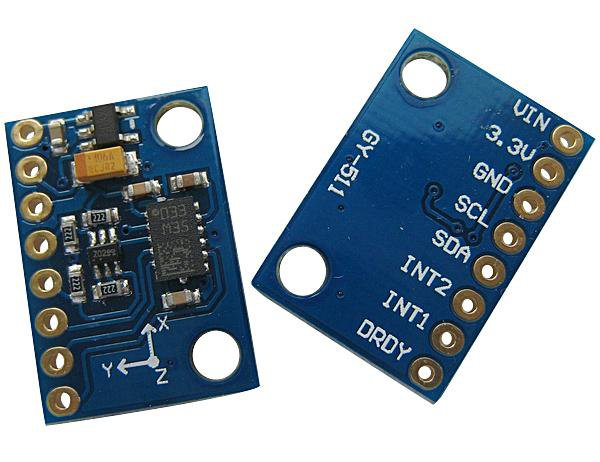

# Buddy 4 — IMU & Terrain Detection

> Your part of the team guide. The shared picture — the event bus (§1.2),
> the non-blocking rule (§1.3), start-up and the mission state machine
> (§2.1–2.2), the `core/` toolbox (§2.3) and the shared hardware (§3) — is
> in [`TEAM_GUIDE.md`](../../TEAM_GUIDE.md); every `§` below points there.
> Installing, building, flashing and testing is [`BUILD.md`](../../BUILD.md).
>
> **Datasheets in this folder:** [`lsm303dlhc.pdf`](lsm303dlhc.pdf) and
> [`OKY3231-2.pdf`](OKY3231-2.pdf) (GY-511 board) describe the LSM303DLHC,
> which is **not** the chip on this car. The car's IMU is an **LSM303D**
> (it answers WHO_AM_I 0x49 at I²C address 0x1D; `drv_imu.c`). An LSM303D
> datasheet is not in this folder (to be added).

**Files:** `app_program/subsystem4/sub_terrain.c/.h`, `terrain_ramp.c/.h`,
`drv_imu.c/.h`, tests in `subsystem4_test.c`

## Your hardware — wiring, pin by pin

**IMU breakout (×1), LSM303D.** It contains an accelerometer (tilt —
how far the nose is up or down, or the car leans sideways, which is how
humps are detected) and a magnetometer (compass), on one die behind one
I²C address (0x1D). **It has no gyroscope.** The breakout's model name and
header labels are to be checked; only its four I²C/power pins are used.
On this car the chip is mounted upside down (Z reads about −1 g when
level); `drv_imu_calibrate()` detects that and flips Z (`z_sign`). Mount it
flat and firmly; a wobbling IMU reports a wobbling road.



(The photo is named for a GY-511 / LSM303DLHC board; whether it shows the
board fitted to the car is to be checked.)

**How to read a Grove socket.** Every Grove socket on the Robo Pico has
four pins, printed on the board in this order: `GND`, `3V3`, then the two
GPIO numbers. A standard Grove cable's wires are colour-coded — **black =
GND, red = 3V3, white = the first GPIO printed, yellow = the second** — but
don't trust colours blindly: hold the cable against the socket and read
which printed label each wire lands on. With a Grove-to-jumper (Dupont)
cable, the four loose ends are what you push onto the sensor's header pins.

Four pins are used — one Grove cable into **Grove 3**:

| Board pin | → Grove 3 label | Why |
|---|---|---|
| power in (`VIN`) | `3V3` (red) | power |
| `GND` | `GND` (black) | ground |
| `SDA` | `GP4` (white) | I²C data — **SDA is GP4**, fixed by the RP2040 chip |
| `SCL` | `GP5` (yellow) | I²C clock — **SCL is GP5** |
| interrupt pins | — | leave empty (the code polls; no interrupt pins needed) |

Swapping SDA and SCL is the most common reason the boot log says
`[S4] IMU: no ACK at 0x1d (WHO_AM_I read failed)` and then
`IMU_UNAVAILABLE (FR15)`. A good boot prints
`[S4] IMU: LSM303D detected (WHO_AM_I=0x49)`.

**How your files connect to the rest of the car** (see §2.3 for what
each `core/` file is)

The IMU does **not** go through `rc_gpioirq` or `rc_defer`: it's polled
over I2C every 10 ms by the shared Sense task, and the I2C bus itself is
driven by the RTOS port's own `dev_i2c` device driver (the
`device/include/dev_i2c.h` include at the top of `drv_imu.c`). The port's
I2C driver queues all the read commands of a transfer at once, with STOP
on the last byte, and takes one RX interrupt per read.

| Your file | Talks to | Through | In plain terms |
|---|---|---|---|
| `drv_imu.c` | the RTOS port's I2C driver | `dev_i2c.h` — `tk_opn_dev("iica")` plus the port's device read/write calls on I2C0 | Reads six bytes of accelerometer and six of magnetometer from the chip at address `0x1D` (both sensors share it; GP4/GP5 because the port's I2C0 pin table is patched, see `rc_config.h`). |
| `drv_imu.c` | the **Sense task** in `rc_sense.c` | `drv_imu_sample()` called every 10 ms | The Sense task is the clock; you don't own a task. |
| `drv_imu.c` | `rc_event` | `rc_event_publish(RC_EVT_IMU_SAMPLE)` | One parcel per sample with the bias-corrected x/y/z acceleration in mg (12-bit fields). Pitch and roll are worked out in `sub_terrain.c`. |
| `drv_imu.c` | `rc_fault` | `rc_fault_set/clear(RC_FAULT_IMU)` | IMU not ready, a failed read, or frozen readings. |
| `drv_imu.c` | `rc_config.h` | `RC_I2C_UNIT_IMU`, `RC_I2C_ADDR_ACCEL`, `RC_I2C_ADDR_MAG`, `RC_IMU_CAL_SAMPLES` | Which bus, the chip address, calibration length. |
| `sub_terrain.c` | `rc_event` | `rc_event_subscribe(RC_EVT_IMU_SAMPLE, RC_LANE_FAST, …)` | Your hump, roll, lift and ramp logic runs inside the FAST dispatcher on every sample. |
| `sub_terrain.c` | `rc_time` | `rc_time_ms()` | How long the hump lasted; lift timers. |
| `sub_terrain.c` | `rc_event` | `rc_event_publish(RC_EVT_HUMP_BEGIN / HUMP_END / RAMP_END / MOTION_CLASS / LIFTED)` | Your conclusions. `HUMP_END` carries the peak height; `LIFTED` sends `sub_nav` to STOPPED. |
| `sub_terrain.c` | `drv_encoder.c` (Buddy 2) | `drv_encoder_count()`, `drv_encoder_speed_mm_s()` | Distance rolled during a hump (a hump needs ≥ 30 mm of travel, and the distance gives a second height estimate), the ramp integrator's distance, and stationary / turning for the motion class. |

Who calls *you*: `subsystem4_start()` calls `drv_imu_init()` and
`drv_imu_calibrate(RC_IMU_CAL_SAMPLES)` once at boot while the car is
still; `sub_nav` calls `sub_terrain_level_here()` on START (re-takes level
and the 1 g reference, resets the ramp height); `sub_telemetry` (Buddy 1)
reads `sub_terrain_height_mm()` for the state message. If `drv_imu_init()`
or the calibration fails, `subsystem4_start()` prints
`IMU_UNAVAILABLE (FR15)` and carries on — hump and lift detection are lost,
but the mission continues.

**What this module does**

This module lets the car feel the ground it's driving on. It uses two
sensors on one small breakout board: an **accelerometer**, which works
like a tilt sensor — it feels which way is "down" and how hard the car is
being pushed or shoved — and a **magnetometer**, which works like a
compass, sensing the Earth's magnetic field to (weakly) tell direction.
Together they let the car notice when it's tipping nose-up over a speed
hump (or leaning when one wheel rides over it), estimate how tall that
hump is, notice that it has been picked up, tilted or turned over (which
stops the run), and tell "driving straight," "turning," "climbing a hump"
and "stopped" apart.
**Important: this board has no gyroscope** (the part that would normally
measure spin rate directly), so the "obvious" textbook approach of
integrating rotation over time to get an angle is not available here —
every trick in this module works around that missing piece.

**Run your module** — build the TEST image (`make TEST=1`), flash it and
read the `[TEST] S4-U..` lines on the USB console (tests listed in
`testing/subsystem4/TEST_LOG.md`). For a bench check of the axes, build
with `S4_IMU_PRINT` 1 (in `drv_imu.c` / `sub_terrain.c`; keep 0 in the
repo): the raw and corrected readings, pitch and roll are printed once a
second. Keep the car level and still while it boots.

**How to get started**

1. **Read the warning comment at the top of `drv_imu.h` first.** It lists
   the three places the missing gyroscope changes the plan: tilt comes
   from gravity, not integration; turning comes from wheel encoders
   (Buddy 2's territory), not the IMU; hump height comes from pitch angle,
   not double-integrated acceleration.
2. **Wire and mount the board.** LSM303D on I²C: SDA→GP4, SCL→GP5,
   power→3V3, GND→GND (one Grove cable into Grove 3; SDA is the
   lower-numbered pin, fixed by the chip).
   Mount it
   **rigidly** — if it's on a wobbly standoff, it registers its own wobble
   as fake terrain.
3. **Bring the driver up.** `drv_imu_init()` (called by
   `subsystem4_start()`) checks WHO_AM_I, then configures the
   accelerometer for 100 Hz sampling across all three axes at ±2 g range
   (0.061 mg per step) and sets the magnetometer to continuous mode.
4. **Calibrate.** With the car level and completely still,
   `drv_imu_calibrate(RC_IMU_CAL_SAMPLES)` (64 samples, ~1 s) takes the
   bias. Because the car is often handled at power-up, `sub_terrain` also
   re-learns level slowly while driving and re-takes it on START
   (`sub_terrain_level_here()`).
5. **Wire up sampling.** `drv_imu_sample()` should be called periodically
   (`RC_PERIOD_IMU_MS`) from the sensing task — it reads both sensors,
   subtracts the calibration bias, and broadcasts an `RC_EVT_IMU_SAMPLE`
   event that `sub_terrain.c` listens for.
6. **Call `sub_terrain_init()`** so the terrain module subscribes to those
   events and starts tracking hump state and motion class.
7. **Tune hump thresholds empirically** — don't guess. Drive hard on flat
   ground with `S4_IMU_PRINT` 1, log pitch and roll, and set
   `PITCH_ENTER_DDEG` in `sub_terrain.c` comfortably above the peak noise
   you see from normal acceleration/braking/cornering. Current values:
   3.0° enter / 2.0° exit, on pitch and roll smoothed over ~160 ms.
8. Register a callback via `sub_terrain_on_hump()` if you want hump
   notifications directly, alongside the `RC_EVT_HUMP_END` event.

**Code walkthrough**

This is the detailed, line-by-line-style companion to the "How to get
started" walkthrough above. It assumes zero prior coding or physics
background, so the first time a term like "gravity vector," "pitch,"
"accelerometer," "endianness," or "bit-shifting" shows up, it's explained
in plain language. It does **not** repeat the event-bus/publish-subscribe
or non-blocking explanations from `TEAM_GUIDE.md` §1.2–1.3 — read those first if
you haven't.

## The two sensors, in plain terms

The LSM303D chip is actually two sensors on one die, behind one I²C
address:

- **Accelerometer** — feels acceleration, i.e. any push or pull on it,
  along three directions at once (X = forward/back, Y = side to side, Z =
  up/down). Here's the trick this whole module is built on: even when the
  car is sitting perfectly still, the accelerometer *still* feels
  something — gravity, pulling everything toward the centre of the
  Earth, at a constant 1 g ("g" is just the name for "how hard gravity
  pulls," used as a unit). Since gravity always points straight down,
  when the car is level, all of that "1 g of downward pull" shows up on
  the Z axis and nothing shows up on X or Y. But tilt the car — say, the
  front end rides up over a speed hump — and gravity doesn't change, but
  the car's *orientation relative to gravity* does: part of that same
  constant downward pull now leaks onto the X axis instead. The more the
  car tilts, the more of that pull shifts from Z onto X. This constant
  "which way is down, and by how much on each axis" reading is called the
  **gravity vector**, and reading how it's split between X and Z is
  exactly how this module measures tilt without ever needing a
  gyroscope.
- **Magnetometer** — a digital compass. It senses the Earth's (very weak)
  magnetic field to estimate which way is magnetic north. It's wired up
  and read in this codebase, but not currently used for navigation — see
  the warning in `drv_imu.h`, quoted below.

**The gyroscope this board doesn't have** would normally measure *rate of
rotation* directly (e.g. "you are currently rotating at 30 degrees per
second") — the textbook way to get an angle is to add up ("integrate")
that rate over time. Without one, this module has to derive tilt from the
gravity vector instead (accelerometer) and derive turning from how much
faster one wheel is spinning than the other (encoders, Buddy 2's
territory) instead of from the IMU at all. `drv_imu.h` opens with exactly
this warning:

> THIS PART HAS NO GYROSCOPE... Tilt must come from the gravity vector in
> the accelerometer, not from integrating a rate. Turn rate has no direct
> source. Use differential encoder counts from Buddy 2... Hump height
> cannot come from double-integrating acceleration; the drift over a two
> second climb is larger than the hump. Estimate peak pitch or roll
> instead and convert with the wheelbase.

(The lift watch in `sub_terrain.c` does integrate vertical acceleration
twice, but only over the fraction of a second a hand lift takes, with
leaks that pull the estimate back to zero.)

Keep that constraint in mind — nearly every unusual-looking piece of math
below exists specifically to work around it.

## `drv_imu.c` / `drv_imu.h` — talking to the chip

This is the "hardware layer": it only knows how to read raw numbers out
of the sensor over **I²C** (pronounced "eye-squared-C") — a simple
two-wire communication protocol (one wire carries data, one carries a
clock signal) that lets several chips share the same two Raspberry Pi
Pico pins, each chip only responding when its own numeric address is sent
first. This file has no opinion about what a "hump" is — that judgment
call belongs entirely to `sub_terrain.c`.

**Registers, and the `#define` constants at the top.** A "register" is
just a numbered memory slot inside the sensor chip — think of it as one
labelled cell in a tiny built-in spreadsheet that you can either write a
setting into, or read a measurement out of. The `#define`s near the top
of `drv_imu.c` give readable names to those slot numbers and to specific
bit patterns written into them, e.g.:

- `A_CTRL1 = 0x20`, written `0x6F` — accelerometer on at 100 samples
  per second (`0x6F` is hexadecimal, base 16, a compact way to write a
  bit pattern), block data update (a burst read never mixes the old and
  new halves of a 16-bit sample) and all three axes enabled. The bits
  are defined by the chip's datasheet, not invented here.
- `A_CTRL2 = 0x21`, written `0x00` — the accelerometer's measurement
  range is ±2 g (as opposed to a wider range like ±8 g). The trade-off:
  a narrower range means each measurable step ("LSB," least-significant
  bit) is a smaller amount of tilt, 0.061 mg here, the precision hump
  detection needs. A wider range would survive a bigger jolt without the
  reading "clipping" (maxing out), at the cost of coarser resolution.
- `M_CTRL5`, `M_CTRL6`, `M_CTRL7` (0x24–0x26) — the magnetometer's
  resolution/rate (100 Hz), full scale (±4 gauss) and continuous mode.
- `D_WHO_AM_I = 0x0F` — the identity register; an LSM303D answers `0x49`.
- `AUTO_INC = 0x80` — explained in detail below, in the accelerometer
  register-trap section.

**`drv_imu_init(void)`.** Opens the I²C bus device by name, reads
WHO_AM_I and refuses anything but `0x49` (a different IMU would need a
different register map), then writes the configuration bytes above. If
the open, the identity check or the accelerometer writes fail, it returns
an error immediately (`RC_ERR_HARDWARE`) rather than limping on — this is
deliberate, so a board that isn't wired up yet fails loudly at boot
instead of silently reporting all-zero tilt forever. The magnetometer
writes are allowed to fail without aborting startup, since the
magnetometer isn't required for the hump/hazard features this module is
graded on.

**`drv_imu_read_accel(int16_t *x, int16_t *y, int16_t *z)` — bytes to
milli-g.** `x`, `y`, `z` here are **pointers** — instead of the function
returning one number, the caller hands it the *addresses* of three
variables it owns (using `&x`, the "address-of" operator, at the call
site), and the function writes results directly into them via
`*x = ...`. This is how C hands back more than one value from a single
function call. The function reads 6 raw bytes back from the chip (2 bytes
per axis) and has to reassemble them into three signed numbers:

1. **Byte order ("endianness").** The accelerometer sends the *low* byte
   of each 16-bit value first and the *high* byte second — the opposite
   of how you'd write the number on paper. So the code does
   `((uint16_t)b[1] << 8) | b[0]` — the `<<` is a **left shift**: it
   slides `b[1]`'s bits 8 positions to the left, i.e. into the *upper*
   half of a 16-bit slot, making room below it; the `|` is a **bitwise
   OR**, which merges two sets of bits together (any bit that's 1 in
   either input becomes 1 in the result) — together they rebuild the
   correct 16-bit value from two separately-received bytes.
2. **Scaling.** On the LSM303D the value fills all 16 bits
   (right-justified, no shift needed), and at ±2 g one step is 0.061 mg.
   So the code multiplies by 61 and divides by 1000, in 32-bit arithmetic
   because ±32767 × 61 does not fit in 16 bits. The result is in milli-g,
   1 g ≈ 1000, which is what everything downstream expects.

The final `(int16_t)` in each line is a **cast** — an explicit instruction
to treat the bits as a particular type, here a signed 16-bit integer,
because tilt can be positive (nose up) or negative (nose down) and the
raw bytes alone don't carry that sign information on their own.

This function calls `reg_read_burst()`, which requests `A_OUT_X_L |
AUTO_INC` as the starting register. `AUTO_INC` (`0x80`) is another
bitwise OR trick: setting the top bit of the register address tells the
chip "after sending me one register's byte, automatically advance to the
next register" — so one request streams back all 6 bytes (X, Y, Z) in
one go, instead of needing 6 separate one-byte requests. Forget this bit
and a multi-byte read comes back with only the first two bytes correct
and garbage after that.

Because this function *blocks* — it waits for the I²C transaction to
finish before returning — it must only be called from a normal task, and
never from an **ISR** (Interrupt Service Routine, a tiny piece of code
the processor jumps to instantly when a hardware event happens, e.g. a
pin changing state — see §1.2 of this guide for the full explanation and
the "golden rule" about what an ISR is and isn't allowed to do).

**`drv_imu_read_mag(int16_t *x, int16_t *y, int16_t *z)`.** Same
output-via-pointer pattern as above. On the LSM303D the magnetometer's
output is also 16-bit, low byte first, in X, Y, Z order, starting at
register `0x08`; it is returned as raw counts with no unit scaling.
Nothing on the car uses it yet (the motors centimetres away would swamp a
compass reading anyway).

**`drv_imu_sample(void)`.** The function the Sense task calls every
10 ms (`RC_PERIOD_IMU_MS`, defined in `rc_config.h`). It does nothing
(and keeps `RC_FAULT_IMU` set) until init and calibration have both
succeeded. Then it reads the accelerometer, subtracts the calibration
bias from each axis, flips Z if the chip is mounted upside down
(`z_sign`), and publishes an `RC_EVT_IMU_SAMPLE` event — the one piece of
data every other function in this module reacts to. The magnetometer is
read but not put on the bus: nothing subscribes to it. Two further
details:

- Z's bias correction only removes the *error* found during calibration,
  not the whole 1 g gravity signal: the pitch, lift and overturn logic
  need that "+1 g on Z when level" reference (and Z below 0 means the car
  is past 90°).
- **Frozen readings.** A working accelerometer never returns exactly the
  same three readings 50 samples (0.5 s) running — its noise alone moves
  them by a few mg. If it does, the chip has stopped converting: the
  driver sets `RC_FAULT_IMU`, prints `[S4] IMU: readings frozen,
  restarting the accelerometer`, rewrites CTRL1/CTRL2 every 0.5 s and
  publishes nothing until the readings move again. A failed read also
  sets the fault; a good, moving reading clears it.

**`drv_imu_calibrate(uint16_t n)`.** Every real accelerometer has a small
built-in offset from manufacturing tolerances and from however it's
actually mounted on your particular car — even sitting dead level, it
won't read *exactly* zero on X and Y. This function takes `n` readings
with the car sitting still and level, adds them up (in a wider 32-bit
running total, since adding many 16-bit numbers can overflow a 16-bit
total), divides by how many readings actually succeeded, and stores the
result as `bias_x`/`bias_y`/`bias_z` — to be subtracted from every future
reading. If the Z sum is negative the chip is upside down: `z_sign` is
set to −1, and `bias_z` holds only the deviation from 1 g. It sleeps briefly between samples (`tk_dly_tsk`, a kernel
"pause this task, let others run" call) rather than looping tight, in
keeping with the non-blocking philosophy from §1.3 — though since this
only runs once before the mission starts, that cost is essentially free
either way. `drv_imu_available()` reports whether init and calibration succeeded
(false = IMU_UNAVAILABLE, FR15).

**Pitch from the accelerometer — `mg_to_ddeg()` in `sub_terrain.c`, the
small-angle approximation explained with the actual numbers.** "Pitch"
means how much the car is tilted nose-up or nose-down, like one end of a
see-saw; "roll" is the same sideways. The proper trigonometric formula
would use `asin()` (inverse sine) — but the RP2040's CPU (a Cortex-M0+)
has **no FPU** (floating-point unit), so real trig functions would have to
be emulated in software, far too slow to run 100 times a second. So the
code uses a shortcut: for small angles (every realistic speed hump), the
*small-angle approximation* says `sin(angle) ≈ angle`, as long as the
angle is measured in radians (2π radians = 360 degrees). Since `ax` (the
accelerometer's X reading, nose-up positive) is proportional to
`sin(pitch)` once you divide by gravity, the calculation collapses to
integer arithmetic:

```c
return ((int32_t)mg * 573) / 1000;
```

Where `573` comes from: the reading is in milli-g, so dividing by 1000
gives a fraction of gravity, which is approximately the angle in radians.
Multiplying by 573 converts radians to *tenths of a degree* in one step:
1 radian = 180/π degrees ≈ 57.3 degrees ≈ 573 tenths. The same function
turns `ay` into roll. The caveat: this only measures tilt correctly when
the car isn't *also* accelerating or braking hard at the same moment,
since a hard brake pushes on the X axis too — which is why the pitch is
smoothed and a hump must also show real wheel travel.

## `sub_terrain.c` / `sub_terrain.h` — deciding what the numbers mean

If `drv_imu.c` is "the ears and inner ear," `sub_terrain.c` is "the part
of the brain that decides what you just felt." It never touches I²C
directly — it only reacts to `RC_EVT_IMU_SAMPLE` events.

**The threshold constants.** `PITCH_ENTER_DDEG` (30, i.e. 3.0°) is how far
nose-up the car must pitch before the code believes a hump has actually
started, and `PITCH_EXIT_DDEG` (20, i.e. 2.0°) is the band the pitch must
settle back inside before the hump is considered finished. Using two
*different* thresholds instead of one is called **hysteresis** — it stops
the reading flickering between "hump" and "not hump" when the pitch sits
near a single threshold. The pitch is first smoothed (`PITCH_SMOOTH_N`
16, ~160 ms) and measured from a learnt level (`level_dev()`, re-learnt
over `LEVEL_TAU` 256 samples, ~2.6 s, only while within 2° of level and
not in a hump), because one raw sample shakes by several degrees while
the motors run and the power-up level is often taken while the car is
being handled. `HUMP_MIN_MS` (150 ms) throws out anything too quick to be
a real hump; `HUMP_FLAT_ABORT_MS` (300 ms) of level ends a climb;
`HUMP_MAX_MS` (10 s) gives up on a climb that's taken too long;
`MIN_HUMP_TRAVEL_MM` (30) requires the wheels to have rolled, so a car
tilted by hand is not a hump; humps lower than `HUMP_MIN_REPORT_MM` (5)
are not reported. The lift thresholds are in `rc_config.h`
(`RC_LIFT_UP_MM`, `RC_LIFT_V_MM_S`, `RC_LIFT_TAN2_PERMILLE`,
`RC_LIFT_TILT_MS`) with the integration constants (`LIFT_*`) at the top of
`sub_terrain.c`.

**The hump state machine, in `on_sample()`.** This function runs every
single time a new IMU sample arrives (about 100 times/second) and
advances a small state machine with three phases, defined as a C `enum`
(a way of giving readable names to a small fixed set of whole-number
states — `H_FLAT` is really just the number 0 under the hood, `H_CLIMBING`
is 1, and so on, but the name is what a human reads):

- **`H_FLAT`** — the default, "nothing happening" state. Every sample,
  it checks whether pitch has crossed above `PITCH_ENTER_DDEG`; if so, it
  switches to `H_CLIMBING`, records the current timestamp, seeds the
  "peak pitch so far" with this first reading, snapshots the distance
  both wheels have rolled since boot (`dist_at_hump_start`, from
  `drv_encoder_count()` — again Buddy 2's territory; not
  `drv_encoder_distance_mm()`, which restarts with every move), and
  publishes `RC_EVT_HUMP_BEGIN`. No hump starts while the car is lifted.
- **`H_CLIMBING`** — keeps updating the running peak-pitch-so-far
  (needed later to compute height), and watches for pitch to swing over
  to clearly nose-down, which means the car has crested the top and moved
  to `H_DESCENDING`. If the pitch instead stays level for
  `HUMP_FLAT_ABORT_MS` without dipping nose-down (the usual case at line
  speed: the front caster rides up and down before the drive wheels
  arrive), the hump finishes there, provided the wheels rolled at least
  `MIN_HUMP_TRAVEL_MM`. If it's been climbing longer than `HUMP_MAX_MS`,
  it gives up and resets straight back to `H_FLAT`.
- **`H_DESCENDING`** — waits for pitch to settle back within the narrow
  exit band. Once it does, if the whole climb-to-settle episode lasted at
  least `HUMP_MIN_MS` (`hump_finish()`), it computes the hump's height (see next section),
  updates the run's tallest hump if this one's bigger, publishes
  `RC_EVT_HUMP_END` with the height/duration/peak-pitch, and calls the
  optional user-registered callback (set via `sub_terrain_on_hump()`) if
  one was registered.

**`pitch_to_height_mm()` — the geometry, worked through with the real
numbers.** The naive approach — integrate acceleration twice to get
position — doesn't work over a hump: over the seconds a climb takes, small
sensor errors compound ("drift") into a height estimate bigger than the
hump itself. Instead, the code treats the car as a rigid ruler of known
length: the front-to-rear axle distance `RC_AXLE_DIST_MM` (drive axle to
the caster's contact point, FR5; **80 mm, still a placeholder to be
measured**, `rc_config.h`). While one end is up on the hump and the other
still on flat ground, the body tilts by the pitch angle, so

```
rise = axle distance * sin(pitch)
```

and, by the small-angle rule, `sin(pitch) ≈ pitch` in radians. In code,
`peak_ddeg` (tenths of a degree) is converted to milliradians with
`* 1745 / 1000` (`ddeg_to_mrad()`; π/1800 rad per tenth of a degree),
multiplied by `RC_AXLE_DIST_MM` and divided by 1000. When the wheels were
turning, `hump_finish()` averages that with a second estimate: half the
distance rolled during the hump × sin(peak pitch). Both are estimates,
not direct measurements.

**`roll_step()` — a hump under one wheel.** On the track the hump is met by
one wheel only, so the car leans sideways instead of pitching. Roll is
smoothed and levelled the same way as pitch; |roll| ≥ 3.0° starts an
episode, level for `HUMP_FLAT_ABORT_MS` ends it, and the wheels must have
rolled `MIN_HUMP_TRAVEL_MM`. The height is `RC_WHEEL_BASE_MM` (112 mm, the
left-right wheel spacing) × sin(peak roll): a 10 mm rise under one wheel
rolls the car about 5°. It is reported as an `RC_EVT_HUMP_END` like a
pitch hump.

**`lift_step()` / `lift_height()` — picked up, tilted, overturned.** On ~40 ms
averages of the three axes:

- **raised:** `lift_height()` takes the vertical acceleration less a learnt
  1 g reference (learnt over ~5 s while within 30 mg, re-taken at START),
  ignores wobbles under 30 mg, clips each bump to 250 mg, and integrates
  it to a rising speed and a height, both leaking back to zero (0.6 s and
  2 s). The car counts as raised once the height reaches `RC_LIFT_UP_MM`
  (20 mm) while still rising at `RC_LIFT_V_MM_S` (120 mm/s) or faster — a
  hand lift is fast, while an offset or vibration only creeps the
  estimate up. A slow, level lift cannot be seen by an accelerometer.
- **tilted:** more than 35° off level (horizontal² > vertical² ×
  `RC_LIFT_TAN2_PERMILLE` 490 / 1000, i.e. tan² 35°) for `RC_LIFT_TILT_MS`
  (300 ms); past 90° (Z ≤ 0) it is reported as **overturned**.

The first of these publishes one `RC_EVT_LIFTED` (`why` 1 raised, 2 tilted,
3 overturned, plus the rise, rising speed and 1 g reference) per episode;
`sub_nav` then stops the run, and `sub_nav_start()` clears the
`RC_FAULT_LIFTED` bit. The episode ends after 500 ms upright and calm;
while it lasts, the hump, roll and ramp logic ignore the samples.

**Ramp height (`terrain_ramp.c`).** A separate integrator adds up
distance × sin(pitch) to give the height above the start
(`sub_terrain_height_mm()`, state field `h`) and publishes
`RC_EVT_RAMP_END` when a two-wheel slope ends. It is fed level while the
car leans (|roll| ≥ 2°) or is lifted, so a one-wheel hump does not count
as a slope. `docs/cr1/README.md` §8 describes it.

**`classify()` — deciding the one-word motion label every sample.** This
function is checked in strict priority order, and the first matching
condition wins:

1. A lift episode is on (`lift_step()`) → `RC_MOTION_LIFTED`.
2. Otherwise, if the hump state machine above is `H_CLIMBING` or a
   one-wheel roll episode is on → `RC_MOTION_CLIMBING`; `H_DESCENDING` →
   `RC_MOTION_DESCENDING`.
3. Otherwise, if both wheel-encoder speeds read zero →
   `RC_MOTION_STATIONARY`.
4. Otherwise, if the left and right encoder speeds differ by more than
   150 mm/s → `RC_MOTION_TURNING`. This is the module's honest
   workaround for having no gyroscope: it falls back entirely to
   `drv_encoder_speed_mm_s()` from **Buddy 2's** motion module — the same
   way a tank or a wheelchair turns by driving its two sides at different
   speeds, a difference between the wheels is direct evidence of turning,
   and it's a more reliable signal than trying to infer rotation from
   this IMU's limited data.
5. Otherwise, a forward/backward push on X beyond `ACCEL_LINEAR_MG`
   (250 mg) classifies as `RC_MOTION_ACCELERATING` or
   `RC_MOTION_DECELERATING`.
6. Otherwise, `RC_MOTION_CRUISING` (steady speed, nothing notable
   happening).

An event (`RC_EVT_MOTION_CLASS`) is only published when the class
actually *changes* — not every single sample — so subscribers like Buddy
1's telemetry module aren't flooded with "still cruising" a hundred times
a second.

**The public API in `sub_terrain.h`.** `sub_terrain_init()` is called
once at boot; it resets internal state and subscribes `on_sample()` to
`RC_EVT_IMU_SAMPLE` on the bus's **fast lane** (hump and lift
detection need to react without delay, the same reasoning as steering).
`sub_terrain_on_hump(cb, ctx)` lets any other module register a plain
function to be called the moment a hump finishes, as an alternative to
subscribing to the event bus directly. `sub_terrain_max_peak_mm()` and
`sub_terrain_motion_class()` are simple getters returning the module's
internally-tracked state; `sub_terrain_height_mm()` returns the ramp
height and `sub_terrain_wcet_us()` the longest `on_sample()` run (test
S4-U09). `sub_terrain_reset()` clears everything back to "just booted,
car still". `sub_terrain_level_here()` (called by `sub_nav_start()` on
START) takes the current pitch, roll and vertical reading as level and
1 g, ends any hump or lift episode and restarts the ramp height.

**Missing / TODO for Buddy 4**

- **Turning classification is a simple threshold.** "Turning" uses the
  left/right encoder speed difference (`TURN_SPEED_DIFF_MM_S`, 150 mm/s),
  not tuned on the car. Needs
  real tuning: verify the threshold against actual turning tests on the
  car, not a guessed constant.
- **Hump height is an estimate.** Validate the pitch and roll estimates
  against a ruler on known humps and quote the error in the terrain
  report. `RC_AXLE_DIST_MM` (80) is still a placeholder to be measured.
- **Lift thresholds need a bench test.** Pick the car up quickly and
  slowly, tilt it and turn it over during a run, and check that hump and
  tile-joint crossings do not stop a run.
