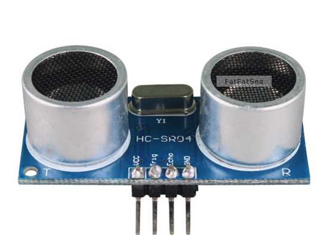
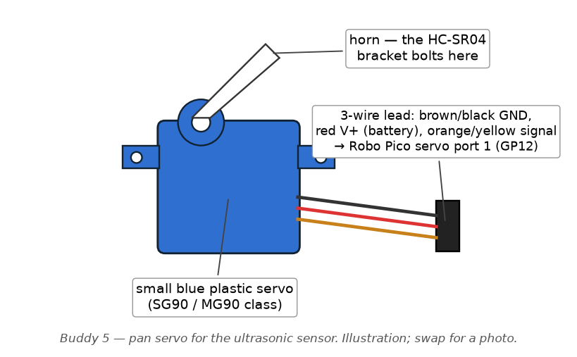
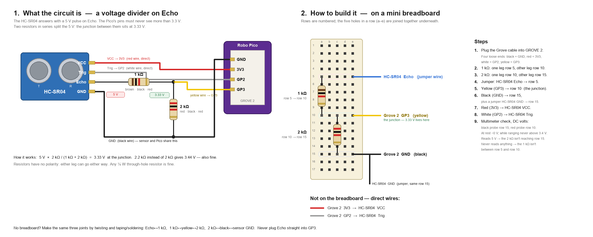

# Buddy 5 — Obstacle Scanning & Avoidance

> Your part of the team guide. The shared picture — the event bus (§1.2),
> the non-blocking rule (§1.3), start-up and the mission state machine
> (§2.1–2.2), the `core/` toolbox (§2.3) and the shared hardware (§3) — is
> in [`TEAM_GUIDE.md`](../../TEAM_GUIDE.md); every `§` below points there.
> Installing, building, flashing and testing is [`BUILD.md`](../../BUILD.md).
>
> **Datasheets for your parts** sit in this folder:
> - [`HCSR04.pdf`](HCSR04.pdf) — the HC-SR04 ranger — timing, 5 V Echo, range limits

**Files:** `app_program/subsystem5/sub_scan.c/.h`, `drv_ultrasonic.c/.h`,
`drv_servo.c/.h`, tests in `subsystem5_test.c`

## Your hardware — wiring, pin by pin

**HC-SR04 ultrasonic ranger (×1).** The blue board with two silver "eyes":
one speaker (T) that shouts an inaudible click, one microphone (R) that
listens for the echo. Four pins: `VCC`, `Trig`, `Echo`, `GND`. Range 2 cm –
4 m; the flight time of the echo is what `drv_ultrasonic.c` measures with
the microsecond stopwatch.

**SG90-class servo + pan bracket (×1).** The small blue plastic servo with a
white horn and a three-wire lead (brown or black = ground, red = power,
orange or yellow = signal). The HC-SR04 bolts to a bracket on the horn so
the scan task can point it from 70° to 110° (±20° around straight
ahead). **Centre the servo at 90° before attaching the bracket**
(`drv_servo_init()` parks it at 90°, a 1500 µs pulse).

 

**How to read a Grove socket.** Every Grove socket on the Robo Pico has
four pins, printed on the board in this order: `GND`, `3V3`, then the two
GPIO numbers. A standard Grove cable's wires are colour-coded — **black =
GND, red = 3V3, white = the first GPIO printed, yellow = the second** — but
don't trust colours blindly: hold the cable against the socket and read
which printed label each wire lands on. With a Grove-to-jumper (Dupont)
cable, the four loose ends are what you push onto the sensor's header pins.

**HC-SR04 → Grove 2**, one Grove cable, **with a resistor divider on the
Echo wire**:

| HC-SR04 pin | → Grove 2 label | Note |
|---|---|---|
| `VCC` | `3V3` (red) | the module prefers 5 V; at 3.3 V it works with shorter range — see `docs/HARDWARE.md` §3 |
| `GND` | `GND` (black) | |
| `Trig` | `GP2` (white) | the Pico's 12 µs "shout" pulse |
| `Echo` | **→ 1 kΩ → `GP3`** (yellow), **and 2 kΩ from `GP3` to `GND`** | see below |

> **Echo outputs 5 V. The Pico's pins are 3.3 V only and are not 5 V
> tolerant — connect Echo directly and you destroy the Pico.** Build the
> divider: Echo wire → one end of a 1 kΩ resistor; the other end of that
> resistor → the `GP3` wire *and* one end of a 2 kΩ resistor; the other end
> of the 2 kΩ → `GND`. The junction between the two resistors is what goes
> to GP3, at 3.33 V. A small breadboard or three solder joints; check it
> with a multimeter before plugging the Grove cable in.



**Building the divider, step by step** (the right half of the picture):

1. Plug the Grove cable into **Grove 2**. Its four loose ends are black =
   `GND`, red = `3V3`, white = `GP2`, yellow = `GP3`.
2. **1 kΩ** (bands brown · black · red): one leg in breadboard row 5, the
   other in row 10.
3. **2 kΩ** (red · black · red; 2.2 kΩ red · red · red is fine too): one
   leg in row 10 — a *different hole* of the same row — the other in row 15.
4. Jumper wire from the HC-SR04's `Echo` pin to row 5.
5. **Yellow (GP3)** into row 10. That row is the junction: 3.33 V lives here.
6. **Black (GND)** into row 15, plus a jumper from the HC-SR04's `GND` to
   row 15 — the sensor and the Pico must share a ground.
7. **Red (3V3)** straight to the HC-SR04's `VCC`; **white (GP2)** straight
   to `Trig`. No resistors on those two.
8. Multimeter on DC volts, black probe in row 15, red probe in row 10: about
   0 V at rest, and never above 3.4 V while the sensor is ranging. If you
   read 5 V the 2 kΩ isn't reaching row 15; if you never read anything the
   1 kΩ isn't between rows 5 and 10.

Resistors have no polarity — either leg can go either way. No breadboard?
Make the same three joints by twisting and taping or soldering: Echo↔1 kΩ,
1 kΩ↔yellow↔2 kΩ, 2 kΩ↔black↔sensor GND.

**Servo → servo header, port 4** (the rightmost of the four columns; the
header's three rows are `S`, `+`, `−` top to bottom):

| Servo wire | → header pin | GPIO |
|---|---|---|
| orange / yellow (signal) | `S`, column 4 | `GP15` |
| red (power) | `+`, column 4 | battery voltage |
| brown / black (ground) | `−`, column 4 | — |

Then `docs/HARDWARE.md` §4.5 steps 2–3: measure your servo's settle time
into `drv_servo.c`, and set `CAR_WIDTH_MM` in `sub_scan.c`.

**How your files connect to the rest of the car** (see §2.3 for what
each `core/` file is)

Two drivers, one subsystem, and you are the heaviest user of `core/` on
the team: the ultrasonic driver alone touches the switchboard, the
stopwatch, the defer list *and* the RP2040's hardware timer alarms.

| Your file | Talks to | Through | In plain terms |
|---|---|---|---|
| `drv_servo.c` | `rc_pwm` | `rc_pwm_init_pin(GP15, 50)`, `rc_pwm_set_pulse_us()` | "Hold this angle" becomes a 1289–1711 µs pulse fifty times a second (70°–110°, 1500 µs = straight ahead). `drv_servo_settle_ms()` estimates how long the horn takes to get there. |
| `drv_ultrasonic.c` | the RTOS's timer interrupts | `tk_def_int(INTNO_TIMER_1 / _2)` directly, NVIC level 3 (the PendSV level, because the handlers call kernel services) | Alarm 1 ends the 12 µs TRIG pulse; alarm 2 gives up if no echo arrives within 30 ms. No delay loops anywhere. |
| `drv_ultrasonic.c` | `core/rc_gpioirq` | `rc_gpioirq_attach(GP3, RC_EDGE_BOTH, …)`, `rc_gpioirq_enable(GP3, on/off)` | "Ring `echo_isr` on both edges" — but only while a ping is live, so a stray edge can't fake a reading. |
| `drv_ultrasonic.c` | `core/rc_time` | timestamps in `echo_isr` | Echo went high at *t1*, low at *t2*; `t2 − t1` in µs × 343 m/s ÷ 2 = distance. |
| `drv_ultrasonic.c` | `core/rc_defer` | `rc_defer_register(ultra_drain)`, `rc_defer_signal_i()` | ISR stores the two timestamps and rings the bell; `ultra_drain` does the division and publishes. |
| `drv_ultrasonic.c` | `rc_event` | `rc_event_publish(RC_EVT_ULTRA_RESULT)` | Range in mm (12 bits, 0 = no echo) and the servo angle it was tagged with. `sub_nav` watches these for the "something ahead" trigger. |
| `drv_ultrasonic.c` | `rc_fault` | `rc_fault_set/clear(RC_FAULT_NO_ECHO)` | The fault bit follows the latest reading. |
| `drv_ultrasonic.c` | `sub_scan.c` | `drv_ultrasonic_on_result(cb)` direct callback | Same result, delivered straight to your subsystem so the scan task can wake immediately (`tk_set_flg` on your own flag). |
| `sub_scan.c` | `drv_servo.c` / `drv_ultrasonic.c` | `drv_servo_set_angle()`, `drv_ultrasonic_ping(angle)` | The scan task points the servo, pings, waits on its flag, repeats: the forward watch (one ping ahead every 60 ms) and the step scan. |
| `sub_scan.c` | `sub_motion.c` / `drv_encoder.c` (Buddy 2) | `sub_motion_drive_speed(0, ±60)`, `sub_motion_stop()`, `drv_encoder_count()` | The step scan turns the chassis in place in 5° steps, measuring the heading from the encoders. |
| `sub_scan.c` | `core/rc_event` | `rc_event_publish(RC_EVT_OBSTACLE_PROFILE)`, `…(RC_EVT_AVOIDANCE_PLAN)` | Your conclusions: where the obstacle is and which way to go round it. |
| `sub_scan.c` | `rc_config.h`, `drv_servo.h` | `RC_PERIOD_SCAN_MS`, `RC_PRI_SCAN`, `RC_WHEEL_BASE_MM`, `RC_ENC_UM_PER_TICK`, `RC_SERVO_HALF_SWING` | Ping period, task priority, chassis-turn geometry, servo swing (±20°). The step-scan constants (`STEP_*`, `SPIN_*`, `OBSTACLE_*`) are at the top of `sub_scan.c`. |

Who calls *you*: `sub_nav` calls `sub_scan_set_watch(true, mm)` while
line-following (one forward ping every 60 ms; also while standing in
IDLE/STOPPED outside TEST builds, where nav ignores the readings),
`sub_scan_start_measure()` once a watch ping comes back at or under the
200 mm trigger (`NAV_WATCH_TRIGGER_MM`) and the car has stopped,
`sub_scan_busy()` / `sub_scan_abort()` on a stop. Your plan comes back to
`sub_nav` as the `RC_EVT_AVOIDANCE_PLAN` event, and `sub_nav` then drives
the bypass using Buddy 2's `sub_motion_*()` calls. The only motor use
inside this module is the step scan's chassis turns (the motors are free
then: `sub_nav` is in AVOIDING and has stopped the car).

**What this module does**

Imagine a bat, or a submarine's sonar operator: shout a short sound, then
listen for the echo bouncing off something in front of you — the longer
the echo takes to come back, the farther away the object is. That's
exactly what the HC-SR04 ultrasonic sensor does, except with an
ultrasonic "click" (40 kHz, above human hearing) instead of a shout.
Because one sensor only measures distance in a single straight line, it's
mounted on a small hobby servo motor — the same kind that swivels a
security camera — so it can be aimed left and right to build up a picture
of what's around the car, not just what's directly ahead. The servo
only swings ±20°, and the beam is wide, so from 20 cm away it never gets
off a 10–20 cm obstacle with the chassis still. Buddy 5's job is to find
both edges of the obstacle with a **step scan** (servo fully to one side,
then the chassis turns a few degrees at a time, stopped for every ping,
until the beam leaves the obstacle's face; then the same on the other
side), turn those readings into a description of the obstacle (how close,
how long, where each edge is relative to the line), and decide whether
the car should go straight, go round on the left, go round on the right,
or stop.

**Run your module** — build the TEST image (`make TEST=1`), flash it and
read the `[TEST] S5-..` lines on the USB console (tests listed in
`testing/subsystem5/TEST_LOG.md`; S5-N02/N04 turn the wheels, so use the
stand). A normal build prints `[step] …` lines for every step scan, and the
MQTT build publishes `car/01/obstacle`, `car/01/avoid` and `car/01/spin`.

**How to get started**

1. **Wire it correctly first** (`docs/HARDWARE.md` §4.5): servo signal →
   GP15 (servo port 4), HC-SR04 on Grove 2: TRIG → GP2, ECHO → GP3
   **through a voltage divider** (1 kΩ ECHO→GP3, 2 kΩ GP3→GND). The
   RP2040 is not 5V
   tolerant and ECHO is a 5V signal — skipping the divider is the fastest
   way to destroy the board.
2. **Centre the servo mechanically at 90° before bolting on the bracket.**
   Power it, command 90° (`drv_servo_init()`'s default), and physically
   mount the bracket so "90°" really points straight ahead.
3. **Measure your actual servo's settle time and update the constants in
   `drv_servo.c`** (`US_PER_DEG`, `SETTLE_FIXED_MS`, used by
   `drv_servo_settle_ms()`). Defaults are rough guesses for a typical 9g
   servo. Getting this wrong makes scans slower than needed or makes them
   ping before the sensor has stopped swinging.
4. **Check `CAR_WIDTH_MM` in `sub_scan.c`** (150: the car's widest point
   plus 40 mm margin). The plan's sideways step is the edge's distance
   from the line plus half of it.
5. Bring-up order: servo centre (S5-U02, check it points straight ahead),
   ultrasonic vs. tape measure at 100/300/1000 mm (S5-U11), then a step
   scan of a box 20 cm ahead (S5-N07) while confirming the motor PID loop
   keeps running smoothly throughout.

**Code walkthrough**

Jargon up front — these terms show up constantly in this module, so get
comfortable with them before reading the code:

- **ISR (Interrupt Service Routine)** — a tiny piece of code the chip
  jumps to *automatically*, the instant some hardware event happens (a
  pin's voltage changes, a timer reaches zero), pausing whatever else was
  running to do it. Think of it like a phone ringing: you drop what
  you're doing, answer briefly, and get back to what you were doing — an
  ISR is expected to be that quick.
- **PWM (Pulse Width Modulation)** — a way to control something (a servo's
  position, a motor's speed) using only an on/off digital pin, by
  controlling *how long* the pulse stays "on" within each repeating time
  slice.
- **Duty cycle** — the fraction of each PWM cycle spent "on." Higher duty
  = more average power/signal.
- **TIMER alarm interrupt** — the RP2040 chip has hardware timers you can
  tell "interrupt me in X microseconds," and then simply forget about —
  no code sits in a loop counting down. When the time's up, the chip
  jumps straight to an ISR you registered ahead of time. This module uses
  two of these (see below) instead of software delay loops.
- **Pointer** — a variable that holds a memory *address* rather than a
  value directly — "where to find the data," not the data itself.
  Function pointers (pointers that hold the address of a *function*) are
  how this codebase implements callbacks: "call me back later," instead
  of "wait right here until you're done."
- **`struct`** — a way to bundle several related values into one named
  unit, like stapling several related fields onto one form instead of
  keeping them as loose separate notes.
- **`static`** (at file scope) — means "only visible inside this one .c
  file." It's how C fakes "private" module state without needing classes.
- **`const`** — a promise to the compiler (and to anyone reading the code)
  that a function won't modify whatever a pointer points to.
- **State machine (`enum` + `switch`/`if` chains)** — a way of writing
  code that can only ever be in one of a small, named set of "modes" at a
  time (e.g. "idle," "moving," "waiting for echo"), and reacts differently
  depending which mode it's currently in. This whole module is built as
  nested state machines — see below.

## `drv_servo.h` / `drv_servo.c` — aiming the sensor

This is the smaller of the two driver files, and does one job: point the
ultrasonic sensor at a given angle, and estimate how long it'll take to
get there. There is no way to *ask* the servo where it currently is — a
cheap hobby servo just accepts a "go here" pulse and trusts you to know
when it's arrived, the way a fax machine has no receipt showing the other
side actually printed the page.

- **`#define SERVO_HZ (50UL)`** — the PWM frame rate for the servo signal:
  one pulse every 1/50th of a second (20 ms). This isn't a tunable
  performance knob, it's just what hobby servos expect by convention —
  fixed by the hardware, not chosen for this project.
- **`#define PULSE_CENTRE_US (1500UL)` / `#define PULSE_HALF_US (211UL)`**,
  giving `PULSE_MIN_US` 1289 and `PULSE_MAX_US` 1711 — the pulse widths
  (in microseconds, within each 20 ms frame) for the ends of the swing,
  `RC_SERVO_ANGLE_MIN` (70°) and `RC_SERVO_ANGLE_MAX` (110°), centred on
  1500 µs for 90° (straight ahead). A hobby servo turns ~10.6 µs per
  degree, so ±20° is ±211 µs. Everything in between is a straight-line
  interpolation. If the sensor does not point straight ahead at rest, move
  `PULSE_CENTRE_US`.
- **`#define SWEEP_DEG (RC_SERVO_ANGLE_MAX - RC_SERVO_ANGLE_MIN)`** — total
  degrees of travel (40), used as the divisor in that same interpolation.
- **`#define US_PER_DEG (2200UL)` and `#define SETTLE_FIXED_MS (25UL)`** —
  this is the pair called out explicitly in the "how to get started"
  section above, and it deserves the "what it does, why, what links to
  it" treatment the brief asks for:
  - **What it does:** `US_PER_DEG` estimates how many microseconds of
    travel time the servo needs *per degree* of movement; divided by 1000
    inside `drv_servo_settle_ms()`, it becomes milliseconds-per-degree.
    `SETTLE_FIXED_MS` is a flat number of extra milliseconds tacked on
    top, to let the mechanical arm stop physically wobbling ("ringing" —
    like a diving board bouncing after someone jumps off) once it
    technically arrives.
  - **Why:** because there's no feedback sensor telling the code "the
    servo has arrived," these two constants are the *entire* basis for
    knowing when a distance reading taken at a new angle can be trusted.
    Too short, and `sub_scan.c` pings before the sensor has physically
    settled, producing readings tagged with the wrong angle or blurred
    by motion. Too long, and every scan takes needlessly longer: every
    ping of the step scan waits for it, so this pair of constants directly
    controls how long the car sits still scanning instead of driving.
  - **Links to other code:** `drv_servo_settle_ms()` (which uses both
    constants) is called from `step_to()` in `sub_scan.c`, which every
    ping of the step scan goes through. Get this wrong, and it shows up as a symptom in
    `sub_scan.c`'s scan timing, not in this file.
- **`drv_servo_init(void)`** — sets up the 50 Hz PWM signal and centers
  the sensor at 90° (straight ahead). Call once at boot, after the
  bracket has been mechanically aligned (see "How to get started" step 2
  above — the code's idea of "90° = straight ahead" only means anything
  if the bracket was bolted on correctly).
- **`drv_servo_set_angle(int16_t deg)`** — the actual "point it here"
  function. First it clamps `deg` to `RC_SERVO_ANGLE_MIN`/`MAX` (70–110)
  so a bug elsewhere can never ask for an angle outside the swing. Then it
  does the pulse-width math:
  ```c
  pulse_us = PULSE_MIN_US
           + (((PULSE_MAX_US - PULSE_MIN_US)
               * (uint32_t)(deg - RC_SERVO_ANGLE_MIN)) / SWEEP_DEG);
  ```
  Read this as: "70° maps to `PULSE_MIN_US`, 110° maps to `PULSE_MAX_US`,
  and everything in between is proportionally in between" — the same
  logic as reading a value off a ruler between two marked ends. It's
  written as multiply-then-divide (not divide-then-multiply) specifically
  to lose as little precision as possible while only using whole-number
  (integer) arithmetic — there's no `float`/`double` anywhere in this
  codebase because the RP2040 chip has no hardware floating-point unit
  (FPU), and doing real decimal math in software would be slow. Finally
  it remembers `last_angle` and hands the pulse width to the PWM driver.
  It returns immediately — it does **not** wait for the servo to actually
  get there.
- **`drv_servo_get_angle(void)`** — returns whatever was last commanded.
  Again: a *command history*, not a live measurement.
- **`drv_servo_settle_ms(int16_t from, int16_t to)`** — see the detailed
  walkthrough of `US_PER_DEG`/`SETTLE_FIXED_MS` above; this function is
  where those two constants actually get combined: distance travelled
  (in degrees) × time-per-degree, plus the fixed settle allowance.

## `drv_ultrasonic.h` / `drv_ultrasonic.c` — the "shout and listen"

This is the most technically interesting file in the module, because of
*how* it avoids blocking the rest of the car while a measurement is in
flight. It's worth understanding the naive alternative first, because the
whole design here is a direct reaction to it.

**The problem it avoids.** A textbook Arduino-style ultrasonic driver
looks like this:

```c
digitalWrite(TRIG, HIGH); delayMicroseconds(10);
digitalWrite(TRIG, LOW);  pulseIn(ECHO, HIGH);
```

Both `delayMicroseconds` and `pulseIn` are **busy-waits** — the processor
sits in a tight loop doing nothing else until the operation finishes.
`pulseIn` in particular can hold the CPU hostage for up to 30
milliseconds if nothing echoes back (sound has to travel out and back, at
about 343 m/s, and the sensor's own max range takes a while to time out).
On this car, the wheel motor control loop needs to run roughly every 20
milliseconds to keep the car driving straight and smooth (see Buddy 2's
PID loop in `sub_motion.c`). A 30ms stall means a missed control update —
visible as a stutter or swerve exactly when the sensor is trying to look
for obstacles, which is precisely the worst possible moment for the car
to lose control.

**The fix: a 5-step interrupt relay.** Instead of one function that waits
the whole way through, the measurement is broken into five tiny pieces,
each one doing only a few microseconds of work and then handing off to
the *next* piece via a hardware interrupt — nothing in software ever sits
and waits. Here's each step, in order, with what hardware event triggers
it and exactly what it does:

1. **`drv_ultrasonic_ping(int16_t tag_angle_deg)`** — called from ordinary
   code (specifically `step_to()` in `sub_scan.c`), not from an
   interrupt. This is where a measurement *begins*. It:
   - Briefly disables all interrupts (`DI(sts)` / `EI(sts)` — Disable
     Interrupts / Enable Interrupts) just long enough to check "is a
     measurement already running?" and, if not, mark one as starting.
     This tiny "critical section" exists so an ISR can never sneak in
     between the check and the set and see the state half-updated — a
     classic bug called a race condition.
   - Records `tag_angle_deg` — the servo angle this measurement is being
     taken at — so that once a result eventually comes back, it can be
     matched to *which direction* it was looking, without extra
     bookkeeping elsewhere.
   - Raises the TRIG pin high (this is the "shout") and arms **TIMER
     alarm 1** to fire again in `RC_ULTRA_TRIG_US` (12 microseconds) —
     the standard trigger pulse length the HC-SR04 datasheet asks for.
     `alarm_arm()` reads the counter and writes the target with
     interrupts off, and if the target has already passed it forces the
     interrupt (`TIMER_INTF`): an RP2040 alarm fires only when the counter
     *equals* its target, so a missed target would otherwise wait 71.6
     minutes for the counter to wrap and the sensor would go silent.
   - Returns immediately. Total time spent: a handful of microseconds.

2. **`trig_done_handler` — triggered by TIMER alarm 1 firing**, exactly
   12µs after step 1 armed it. This is the chip's own hardware clock
   jumping straight to this function; nothing was sitting and counting
   down in software. It:
   - Clears its interrupt flag (hardware or forced) and ignores a late
     duplicate (state not `ST_TRIG`).
   - Drops TRIG back to low — the trigger pulse is over, and the HC-SR04
     has (by now) started emitting its 40kHz "click" and preparing to
     listen for the echo.
   - **Un-masks (enables) the ECHO pin's interrupt.** This is the key
     idea that makes the *listening* half interrupt-driven too: from this
     instant on, any voltage change on the ECHO pin will itself
     automatically trigger step 3/4 below — no polling loop needed.
   - Arms **TIMER alarm 2** as a timeout safety net (step 5), in case the
     echo never comes back at all.

3. **`echo_isr` (rising edge) — triggered the instant the ECHO pin goes
   high.** The HC-SR04 raises ECHO the moment it starts listening for the
   sound to bounce back, so the pin itself is effectively a stopwatch
   button. This handler just records the current microsecond timestamp
   into `t_rise` and moves the internal state machine on to "waiting for
   the echo to end."

4. **`echo_isr` (falling edge) — triggered the instant the ECHO pin drops
   back to low**, meaning the sensor detected the reflected sound. It
   computes `t_us - t_rise` — exactly how long ECHO stayed high, in
   microseconds — and hands that duration off to `finish_i()`. Crucially,
   the actual *division* needed to turn microseconds into millimetres
   (via the `US_TO_MM` macro) does **not** happen here — it's deferred to
   a "bottom half" function, `ultra_drain()`, that runs later in the
   defer task. The golden interrupt rule applies directly here: an ISR
   may only record a timestamp and hand
   off, never do the heavier work (division, publishing an event, calling
   a user callback) itself. `finish_i()` also does the two things that
   genuinely *can't* wait — masking the ECHO pin's interrupt back off
   (so a noisy, ringing 5V-to-3.3V voltage divider can't keep firing
   spurious interrupts while the car is busy doing something else) and
   cancelling the now-unnecessary timeout alarm.
5. **`timeout_handler` — triggered by TIMER alarm 2 firing**, if steps 3
   and 4 never happened within `RC_ULTRA_TIMEOUT_US` of step 2 arming it.
   This is the safety net: if nothing echoes back at all (nothing is in
   front of the sensor, or it's too far away, too soft to reflect sound,
   or angled away), this fires instead and reports an *invalid* reading —
   so a scan can never get stuck waiting forever for a result that will
   never arrive.

**Why two TIMER alarms and not one?** Because two independent countdowns
are needed simultaneously at different points: one to time the outgoing
12µs trigger pulse (alarm 1), and a separate one to time the maximum
allowed wait for a returning echo (alarm 2). They're both RP2040 hardware
peripherals reserved specifically because this project's underlying RTOS
port doesn't otherwise use them (see the comment at the top of
`drv_ultrasonic.h`).

**The math constant worth knowing:**
```c
#define US_TO_MM(us)  (((us) * 343UL) / 2000UL)
```
Speed of sound is roughly 343 metres/second at room temperature. The echo
travels *out and back* (to the obstacle and then all the way back to the
sensor), so the raw one-way distance is half of what the round-trip time
would suggest — that's where the extra factor of 2 comes from (`/2000`
instead of `/1000`, folding the unit conversion and the "divide by two
for round trip" into one division). It's written as a macro (compiler
text-substitution, not a real function call) so it's essentially free to
use, and it works directly on whatever integer width is handed in.

**Result delivery — `ultra_drain()` and `RC_EVT_ULTRA_RESULT`.** Once
`finish_i()` has stashed a raw measurement, it calls
`rc_defer_signal_i()` to request that `ultra_drain()` run soon, in normal
task context (the defer task). `ultra_drain()` converts the width to
millimetres, checks it against `RC_ULTRA_MIN_MM`/`RC_ULTRA_MAX_MM`
(treating it as no echo if out of the sensor's honest working range),
updates `RC_FAULT_NO_ECHO`, then publishes `RC_EVT_ULTRA_RESULT` on the
shared event bus (12-bit range, **0 = no echo**, no separate valid flag;
a real echo never reads 0) and — if one was registered via
`drv_ultrasonic_on_result()` — calls a direct callback too. `sub_scan.c`'s
`on_range()` is exactly that callback: it keeps the latest reading and
wakes the scan task.

## `sub_scan.h` / `sub_scan.c` — scanning, profiling, and planning

This file is where the two drivers above get orchestrated into an actual
behaviour: look ahead, measure an obstacle, decide what to do about it.
It is built as **two nested state machines** — the top-level scan state
(`S_IDLE` / `S_WATCH` / `S_STEP`) plus the ping/echo state machine inside
`drv_ultrasonic.c` underneath it.

**The kernel objects.** `scan_task` (priority `RC_PRI_SCAN`, 8) does all
the work and sleeps nearly all the time:

- **`scan_semid`**, a semaphore (max count 1) that counts scan requests:
  `sub_scan_start_measure()` signals it and `scan_task` takes it. A count
  cannot be lost the way a flag bit can be cleared by someone else; a
  second request before the first is taken is the same request.
- **`scan_flgid`**, an event flag with two bits: `FLG_RESULT` ("a ping just
  produced a result", set by `on_range()`) and `FLG_ABORT` ("stop what's
  running", set by `sub_scan_abort()`). Waits use `TWF_BITCLR`, which
  clears only the bits waited for, so a wait for a result can never wipe
  an abort (or the other way round). A stale abort is cleared when the
  next request is made, and a stale result before a scan starts.

**`scan_task(INT stacd, void *exinf)`** — the background task, running
forever. Each time through the loop:

- In `S_WATCH` (the forward watch, see below) it points the servo ahead,
  pings once, waits for the result, sleeps `RC_PERIOD_SCAN_MS` (60 ms) and
  loops.
- Otherwise it waits on `scan_semid` (100 ms timeout, so it re-checks
  `S_WATCH`). When a request arrives it runs the step scan (`run_step()`),
  then `publish_and_finish()`, and goes back to `S_WATCH` if a watch is
  on, else `S_IDLE`.

**`step_to(int16_t angle)`** — every ping goes through it: ask
`drv_servo_settle_ms()` how long the move will take, command the servo,
**sleep that long via `tk_dly_tsk()`** (a genuine kernel sleep — the task
is off the CPU, not spinning), then start one ping. **`wait_result()`**
then sleeps until `FLG_RESULT` or `FLG_ABORT`, or 100 ms as a safety
timeout (the ultrasonic driver has its own 30 ms timeout, so this only
catches a wedged measurement).

**The step scan — `run_step()` and `step_side()`.** Headings are measured
from the line, > 0 = left, in tenths of a degree; the chassis heading
comes from the encoders (`spin_heading()`: mean wheel travel since the
turn began, over the wheel travel per degree of spin, less the slip
`SPIN_TURN_EFF_PERMILLE` 800).

1. Ping straight ahead (`STEP_PINGS` 2 pings per stop, the nearest valid
   one counts). If nothing is within `OBSTACLE_MM` (400 mm), stop: there
   is nothing to measure. Otherwise that range is the obstacle's face.
2. For the left side, then the right side (`step_side()`):
   - servo fully out to that side (`RC_SERVO_HALF_SWING`, 20°), chassis
     straight: ping;
   - while the echo still comes from the face (`step_on_face()`: no
     further than the face's plane along the beam plus
     `SPIN_DEPTH_BAND_MM` 25), turn the chassis `STEP_CHASSIS_DDEG` (5°)
     further that way (`chassis_to()`: spin at `STEP_TURN_MM_S` 60 mm/s,
     stop, settle 150 ms, read the heading), and ping again — stopped for
     every ping, so there is no turning-while-pinging lag;
   - at the first heading where it does not, walk the servo back
     `STEP_FINE_DEG` (1°) at a time until the face echoes again: the edge
     is between the two, to within ±0.5°;
   - if the beam is still on the face once it points past where the corner
     of the longest allowed obstacle could be (`OBSTACLE_MAX_MM`, 250 mm
     out from the line; `step_past_max()`), that side has no edge;
   - chassis back to straight.
3. Servo back to 90°, motors stopped.

How far the chassis turns therefore follows from the obstacle (roughly
10–15° for a 10 cm one), not from a fixed swing. An abort (or a chassis
turn that does not get there within ~2 s) ends the scan early.

**The profile — `step_profile()`.** Each edge found becomes a corner
position across the line. The sensor sits `SPIN_SENSOR_AHEAD_MM` (85 mm)
ahead of the wheel axle (the spin centre); with chassis heading φ, beam
heading ψ, the beam's half-width β (`SPIN_BEAM_HALF_DDEG`, 8°) and range
r, the corner is at

```
x = -(A sin φ + r sin(ψ - side × β))
```

(`isin()` is a sine table in 1° steps, interpolated; there is no FPU).
`closest_mm` is the face range, `width_mm` the distance between the two
corners (0 if either edge was not found), `clearance_left_mm` /
`clearance_right_mm` each corner's distance from the line (0 = that edge
was not found, so the obstacle may run on past the scan), `n_points` the
number of stops pinged. The edges also go out as `RC_EVT_SPIN_EDGES`
(`car/01/spin`) for diagnostics.

**The decision — `spin_plan()`.** Takes the profile and turns it into one
of:

- **go straight** — nothing within `OBSTACLE_MM`;
- **stop** — neither edge found;
- **go round on the side away from the obstacle**: with both edges seen,
  if the obstacle's centre is right of the line (or on it) go left, else
  right; with one edge unseen, the obstacle reaches past the scan on that
  side, so go round the other side. `lateral_mm` is that side's edge
  distance from the line plus half `CAR_WIDTH_MM`; `forward_mm` is how far
  ahead of the axle's present position the axle must get before turning
  back in: sensor offset + face range + the obstacle's depth (taken as
  square: its measured length, capped at `OBSTACLE_MAX_MM`, which is also
  used when an edge was not seen) + the car's rear overhang
  (`SPIN_REAR_MM` 55) + a margin (`SPIN_PAST_MARGIN_MM` 30).

`spin_plan()` only *decides*; `sub_nav` drives the bypass (45° out,
parallel, 45° in, then a line scan to rejoin) with Buddy 2's
`sub_motion` calls.

**Reporting the result — `publish_and_finish()`.** Builds the profile and
plan, publishes `RC_EVT_OBSTACLE_PROFILE`, `RC_EVT_AVOIDANCE_PLAN` and
`RC_EVT_SPIN_EDGES`, and sets the state back to idle. `sub_nav` subscribes
to `RC_EVT_AVOIDANCE_PLAN` (in AVOIDING); `sub_telemetry` (Buddy 1)
reports all three.

**`on_range(uint16_t range_mm, bool valid, void *ctx)`** — registered with
the ultrasonic driver as its result callback, so it runs in the defer
task. It stores the latest reading and sets `FLG_RESULT` to wake
`scan_task`.

**Continuous forward watch — `sub_scan_set_watch(bool on, uint16_t
trigger_mm)`.** While the car is line-following, one ping straight ahead
every `RC_PERIOD_SCAN_MS`, each result published as
`RC_EVT_ULTRA_RESULT`. `trigger_mm` is accepted but not used here:
`sub_nav` subscribes to `RC_EVT_ULTRA_RESULT` itself and decides when a
reading is close enough (200 mm) to stop and call
`sub_scan_start_measure()`.

**Public API (`sub_scan.h`).** `sub_scan_init()` creates the flag, the
semaphore and the task and registers `on_range()` (call once at boot,
after `drv_servo_init()` and `drv_ultrasonic_init()`);
`sub_scan_start_measure()` requests a step scan (returns at once,
`RC_ERR_BUSY` if one is running; the motors must be free);
`sub_scan_busy()` is true while a scan runs (not the watch);
`sub_scan_abort()` stops a running scan and drops a request not yet taken;
`sub_scan_set_watch()` turns the forward watch on or off.

**Missing / TODO for Buddy 5**

- **Length accuracy is limited by the sensor.** The HC-SR04 sees a flat
  face only over a narrow angle and its beam is wide; `SPIN_BEAM_HALF_DDEG`
  and `SPIN_TURN_EFF_PERMILLE` are fitted values to re-check on a known
  object.
- **No "reverse and reattempt" case.** The project brief calls for this,
  but `spin_plan()` returns `RC_CMD_STOP` when neither edge was found —
  it stops rather than backing up and trying again.
- **Single-ping trigger.** `sub_nav` starts avoidance on one watch reading
  at or under 200 mm; a stray short reading can stop the car for a scan.
